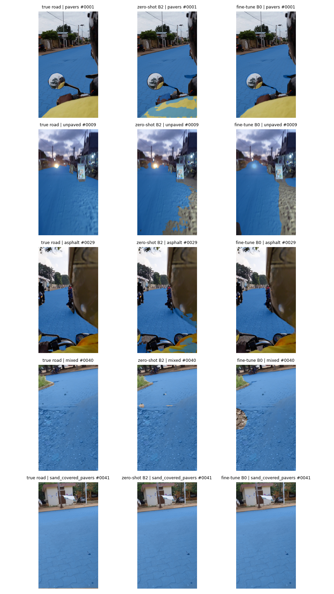

# RoadSense

[English](#english) | [Français](#francais)



---

<a id="english"></a>

## English

**Do road segmentation models trained on European streets work on West African roads? And when they fail, is it because the road *looks* different, or because it does not fit their *definition* of a road?**

RoadSense is a small road segmentation dataset filmed in Cotonou and Abomey-Calavi (Benin), and a first study of how Cityscapes-trained models behave on it: asphalt, pavers, sand-covered pavers and unpaved sandy roads.

### Key findings

- **No collapse.** SegFormer models trained on Cityscapes reach a pooled road IoU of 0.86 (B0) and 0.88 (B2) zero-shot. Unpaved roads are the hardest surface.
- **A definition gap, not only an appearance gap.** On unpaved roads, most road pixels the models miss are labelled `sidewalk` (41 % for B0, 59 % for B2): the model sees a flat ground surface but does not call it a road.
- **59 local images are enough to beat a 6x larger model.** Fine-tuned on 59 annotated images, SegFormer-B0 reaches 0.903, above the zero-shot B2 (0.880). The gain is concentrated on unpaved roads (+0.09).
- **Asphalt barely changes**, in dry or rainy conditions, even though rain is absent from the training set.

### Results

Pooled road IoU on the test set (63 images, binary road / background):

| Surface | Test images | B0 zero-shot | B2 zero-shot | B0 fine-tuned |
| --- | --- | --- | --- | --- |
| unpaved | 23 | 0.816 | 0.847 | **0.904** |
| asphalt | 21 | 0.847 | 0.868 | 0.845 |
| sand_covered_pavers | 10 | 0.966 | 0.971 | 0.977 |
| pavers | 8 | 0.884 | 0.844 | 0.934 |
| mixed | 1 | 0.990 | 0.988 | 0.958 |
| **All** | **63** | **0.863** | **0.880** | **0.903** |

Where the missed road pixels go (zero-shot, % of missed road pixels, main classes):

| Surface | B0 | B2 |
| --- | --- | --- |
| unpaved | sidewalk 41, vegetation 39, building 14 | sidewalk 59, vegetation 19, wall 13 |
| asphalt | vegetation 58, sidewalk 11, building 9 | sidewalk 38, person 21, car 14 |
| pavers | person 31, car 24, sidewalk 23 | car 23, sidewalk 19, building 18, person 18 |
| sand_covered_pavers | vegetation 81, sidewalk 9 | vegetation 73, sidewalk 15 |

On pavers and asphalt, a large share of the misses go to `person`, `car` and `rider`: these are mostly disagreements at object boundaries. On sand-covered pavers the IoU is already 0.97, so the `vegetation` share concerns very few pixels.

Asphalt, dry vs rain (road IoU in %, SegFormer-B0):

| Weather | Test images | Zero-shot | Fine-tuned |
| --- | --- | --- | --- |
| dry | 13 | 80.0 | 78.4 |
| rain | 8 | 91.8 | 93.0 |

### Data

- 18 phone videos filmed in September and October 2026 in Cotonou and Abomey-Calavi, from a motorbike (often as a passenger) and on foot. Frames extracted at 1 per second, blurry and near-duplicate frames removed.
- 235 frames selected: **63 test** (one took back), **59 train**, **112 to pre-annotate**. Test frames come from videos or time blocks never used for training, to avoid near-duplicate leakage.
- Annotated by hand in CVAT with a single `road` label: any flat, continuous surface a motorbike or car can drive on, whatever the material. Full rules in [ANNOTATION_GUIDE.md](ANNOTATION_GUIDE.md).
- Each frame is tagged with its surface type, lighting and weather ([data/index.csv](data/index.csv)).

**The images are not public yet**: they show people and licence plates that are not anonymised. A public release is planned after anonymisation. The data is available on request for research use.

### Method

1. **Zero-shot baseline.** `nvidia/segformer-b0-finetuned-cityscapes-1024-1024` and `nvidia/segformer-b2-finetuned-cityscapes-1024-1024`, inference at 1536 x 864. A pixel is road when the predicted Cityscapes class is `road`. For each missed road pixel we record the class predicted instead.
2. **Fine-tuning.** SegFormer-B0 from the Cityscapes weights, 2-class head (background, road), 59 training images, AdamW (lr 6e-5, linear decay), batch 4, about 2,000 steps, random crop, flip and colour jitter, at 768 x 432. About 9 minutes on a Kaggle T4.
3. **Metric.** Pooled IoU per surface: intersections and unions are summed over the images of a group before dividing. Predictions are scored at the full 1080 x 1920 resolution.

Everything is in [notebooks/roadsense-v1.ipynb](notebooks/roadsense-v1.ipynb), with outputs kept so results can be read without running it.

### Limitations

- **One training run.** A previous run with the same recipe differed by up to 0.03 per surface (asphalt 0.813, unpaved 0.926). Smaller differences are not meaningful.
- **Small groups.** `mixed` has 1 test image and `pavers` 8. All rain images come from a single video, so weather and video are confounded.
- **Single annotator**, and the test set is small (63 images).
- Zero-shot and fine-tuned models are evaluated at different input sizes, each close to its training scale.

### Next steps

- Correct the 112 pre-annotated images and train on about 170 images.
- Cost curve: performance vs number of annotated images (10, 25, 50, 100+), 3 seeds each.
- ImageNet vs Cityscapes initialisation: what does the European pre-training actually bring?
- Check whether fine-tuning removes the `sidewalk` confusion on unpaved roads.
- Road condition (potholes, flooded sections) in a later phase.

### Repository

```
ANNOTATION_GUIDE.md          annotation rules
notebooks/
  roadsense-v1.ipynb         baseline, fine-tuning, pre-annotation, asphalt analysis
data/
  index.csv                  one row per image: split, surface, lighting, weather
results/
  *.csv                      result tables
  qualitative_v0.png         qualitative figure
  preannotations_*.xml       pre-annotations for CVAT (CVAT 1.1 format)
```

### Author

Freud Arthur BOKOSSA, Bachelor student in Artificial Intelligence, IFRI, Université d'Abomey-Calavi (Benin).

### Licence

Code under the MIT licence. The licence does not cover the images, which are not distributed here.

---

<a id="francais"></a>

## Français

**Les modèles de segmentation de route entraînés sur des rues européennes fonctionnent-ils sur les routes d'Afrique de l'Ouest ? Et quand ils échouent, est-ce parce que la route *a l'air* différente, ou parce qu'elle ne correspond pas à leur *définition* d'une route ?**

RoadSense est un petit dataset de segmentation de route filmé à Cotonou et Abomey-Calavi (Bénin), accompagné d'une première étude du comportement des modèles entraînés sur Cityscapes : goudron, pavés, pavés recouverts de sable et pistes en terre sableuse.

### Résultats clés

- **Pas d'effondrement.** Les modèles SegFormer entraînés sur Cityscapes atteignent une IoU route poolée de 0.86 (B0) et 0.88 (B2) sans aucun entraînement local. Les pistes en terre sont la surface la plus difficile.
- **Un problème de définition, pas seulement d'apparence.** Sur les pistes en terre, la plupart des pixels de route ratés sont classés `sidewalk` (41 % pour B0, 59 % pour B2) : le modèle voit une surface plane, mais ne l'appelle pas route.
- **59 images locales suffisent pour battre un modèle 6 fois plus gros.** Fine-tuné sur 59 images annotées, SegFormer-B0 atteint 0.903, au-dessus de B2 zero-shot (0.880). Le gain se concentre sur les pistes en terre (+0.09).
- **Le goudron bouge à peine**, par temps sec comme sous la pluie, alors que la pluie est absente du jeu d'entraînement.

### Résultats

IoU route poolée sur le jeu de test (63 images, route / fond) :

| Surface | Images de test | B0 zero-shot | B2 zero-shot | B0 fine-tuné |
| --- | --- | --- | --- | --- |
| unpaved (terre) | 23 | 0.816 | 0.847 | **0.904** |
| asphalt (goudron) | 21 | 0.847 | 0.868 | 0.845 |
| sand_covered_pavers (pavés ensablés) | 10 | 0.966 | 0.971 | 0.977 |
| pavers (pavés) | 8 | 0.884 | 0.844 | 0.934 |
| mixed (mixte) | 1 | 0.990 | 0.988 | 0.958 |
| **Total** | **63** | **0.863** | **0.880** | **0.903** |

Où partent les pixels de route ratés (zero-shot, en % des pixels ratés, classes principales) :

| Surface | B0 | B2 |
| --- | --- | --- |
| unpaved | sidewalk 41, vegetation 39, building 14 | sidewalk 59, vegetation 19, wall 13 |
| asphalt | vegetation 58, sidewalk 11, building 9 | sidewalk 38, person 21, car 14 |
| pavers | person 31, car 24, sidewalk 23 | car 23, sidewalk 19, building 18, person 18 |
| sand_covered_pavers | vegetation 81, sidewalk 9 | vegetation 73, sidewalk 15 |

Sur les pavés et le goudron, une grande part des erreurs va vers `person`, `car` et `rider` : ce sont surtout des désaccords au bord des objets. Sur les pavés ensablés, l'IoU est déjà de 0.97, donc la part `vegetation` concerne très peu de pixels.

Goudron, sec vs pluie (IoU route en %, SegFormer-B0) :

| Météo | Images de test | Zero-shot | Fine-tuné |
| --- | --- | --- | --- |
| sec | 13 | 80.0 | 78.4 |
| pluie | 8 | 91.8 | 93.0 |

### Données

- 18 vidéos filmées au téléphone en septembre et octobre 2026 à Cotonou et Abomey-Calavi, depuis une moto (souvent en passager) et à pied. Images extraites à 1 par seconde, images floues et quasi doublons retirés.
- 235 images sélectionnées : **63 de test**(une retirée), **59 d'entraînement**, **112 à pré-annoter**. Les images de test viennent de vidéos ou de passages jamais utilisés pour l'entraînement, pour éviter les fuites entre images presque identiques.
- Annotation manuelle dans CVAT avec un seul label `road` : toute surface plane et continue sur laquelle une moto ou une voiture peut rouler, quel que soit le matériau. Règles complètes dans [ANNOTATION_GUIDE.md](ANNOTATION_GUIDE.md) (en anglais).
- Chaque image est taguée avec son type de surface, l'éclairage et la météo ([data/index.csv](data/index.csv)).

**Les images ne sont pas encore publiques** : on y voit des personnes et des plaques d'immatriculation non anonymisées. Une publication est prévue après anonymisation. Les données sont disponibles sur demande pour un usage de recherche.

### Méthode

1. **Point zéro (zero-shot).** `nvidia/segformer-b0-finetuned-cityscapes-1024-1024` et `nvidia/segformer-b2-finetuned-cityscapes-1024-1024`, inférence en 1536 x 864. Un pixel est de la route quand la classe Cityscapes prédite est `road`. Pour chaque pixel de route raté, on enregistre la classe prédite à la place.
2. **Fine-tuning.** SegFormer-B0 à partir des poids Cityscapes, nouvelle tête à 2 classes (fond, route), 59 images d'entraînement, AdamW (lr 6e-5, décroissance linéaire), batch de 4, environ 2 000 itérations, recadrage aléatoire, miroir et variation de couleur, en 768 x 432. Environ 9 minutes sur un GPU T4 de Kaggle.
3. **Métrique.** IoU poolée par surface : les intersections et les unions sont additionnées sur toutes les images d'un groupe avant la division. Les prédictions sont évaluées à la pleine résolution 1080 x 1920.

Tout est dans [notebooks/roadsense-v1.ipynb](notebooks/roadsense-v1.ipynb) (en anglais), avec les sorties conservées pour lire les résultats sans le relancer.

### Limites

- **Un seul entraînement.** Un run précédent avec la même recette différait jusqu'à 0.03 par surface (goudron 0.813, terre 0.926). Les écarts plus petits ne sont pas interprétables.
- **Petits groupes.** `mixed` n'a qu'une image de test et `pavers` 8. Toutes les images de pluie viennent d'une seule vidéo : l'effet de la météo et celui de la vidéo sont confondus.
- **Un seul annotateur**, et un jeu de test réduit (63 images).
- Les modèles zero-shot et fine-tuné sont évalués à des tailles d'entrée différentes, chacun proche de son échelle d'entraînement.

### Suite

- Corriger les 112 images pré-annotées et entraîner sur environ 170 images.
- Courbe de coût : performance en fonction du nombre d'images annotées (10, 25, 50, 100 et plus), 3 graines chacune.
- Initialisation ImageNet contre Cityscapes : qu'apporte vraiment le pré-entraînement européen ?
- Vérifier si le fine-tuning supprime la confusion `sidewalk` sur les pistes en terre.
- État de la route (nids de poule, passages inondés) dans une phase ultérieure.

### Organisation du dépôt

```
ANNOTATION_GUIDE.md          règles d'annotation
notebooks/
  roadsense-v1.ipynb         point zéro, fine-tuning, pré-annotation, analyse du goudron
data/
  index.csv                  une ligne par image : split, surface, éclairage, météo
results/
  *.csv                      tableaux de résultats
  qualitative_v0.png         figure qualitative
  preannotations_*.xml       pré-annotations pour CVAT (format CVAT 1.1)
```

### Auteur

Freud Arthur BOKOSSA, étudiant en Licence Intelligence Artificielle, IFRI, Université d'Abomey-Calavi (Bénin).

### Licence

Code sous licence MIT. La licence ne couvre pas les images, qui ne sont pas distribuées ici.
